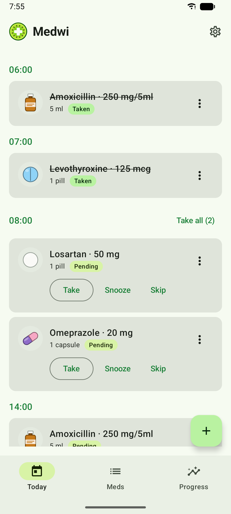
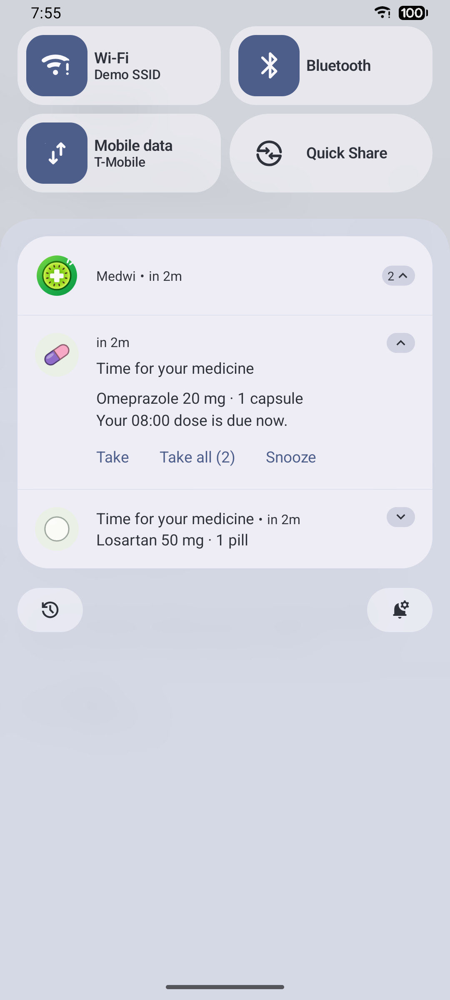
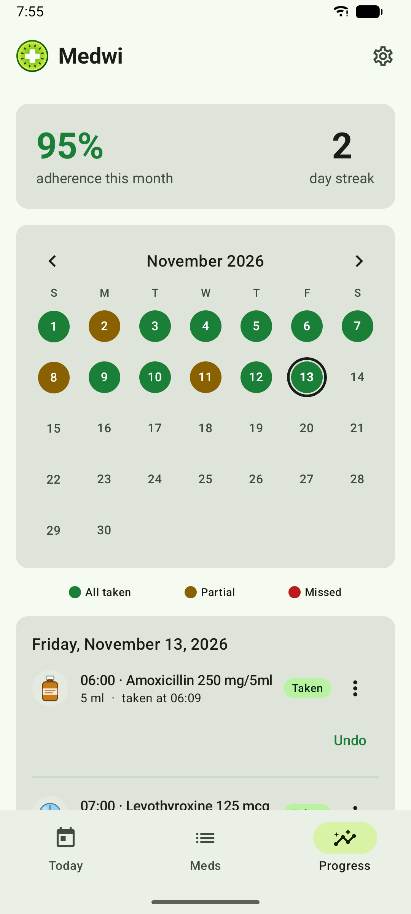
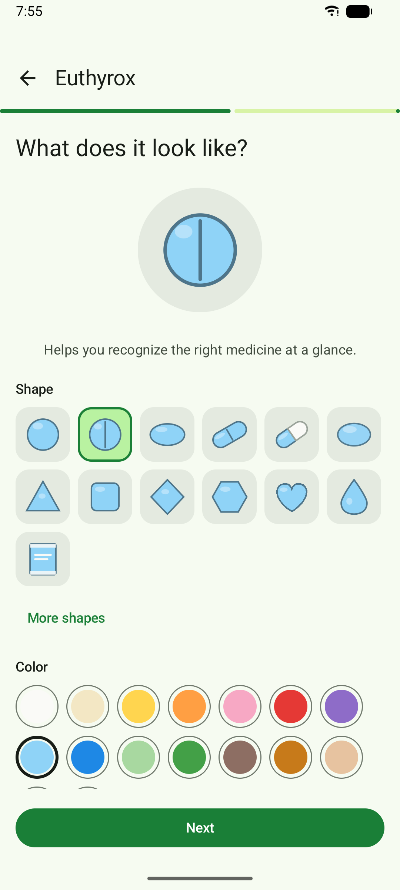

<p align="center">
  
</p>

<h1 align="center">Medwi</h1>

<p align="center">
  Offline medication reminders for Android that go off on time and need no account.
</p>

Medwi is an Android app that reminds you to take your medicines on time and keeps a simple
history of what you took. All data stays on the device: no account, no ads, no analytics and
no network access.

<p align="center">
  
  
  
  
</p>

## Features

- Reminders use exact alarms that survive reboots and Doze. Notifications are sticky and repeat until answered (Take / Snooze / Skip), and "Take all" covers medicines that share a time.
- A reliability checklist walks the user through the settings that block reminders: notifications, exact alarms, battery optimization and OEM auto-start managers.
- Schedules can repeat every day, every X days/weeks/months, on specific weekdays or in cycles (e.g. 21 + 7), or a medicine can be taken as needed. An interval organizer spreads N doses every 24/N h, and doses can vary over time for tapering or titration.
- Each medicine has a strength (125 mg, 10 mg/ml…), real dose units with plural forms, and a pill shape and color drawn in code. Stock tracking sends refill reminders. A treatment can be paused or ended without losing its history.
- A monthly adherence calendar shows the history, and any day can be reviewed and corrected. There is also a home-screen widget (Glance).
- An optional app lock uses the phone's own biometrics or PIN. It also hides medicine names on the lock screen and in the widget.
- Three backup options, described under [Backups](#backups).
- Available in English and Brazilian Portuguese.

## Install

<p align="center">
  <a href="https://apps.obtainium.imranr.dev/redirect?r=obtainium://add/https://github.com/butialabs/medwi"></a>
</p>

- [Obtainium](https://github.com/ImranR98/Obtainium): tap the badge above on your phone, or add `https://github.com/butialabs/medwi` in Obtainium. It installs the GitHub release APK and keeps it updated.
- [F-Droid](https://f-droid.org/packages/br.com.butialabs.medwi/): built from source by F-Droid and signed with F-Droid's key (pending inclusion).
- GitHub Releases: every [release](../../releases) has a signed APK attached.

The F-Droid build and the GitHub/Obtainium build have different signatures, so Android won't
update one with the other. To switch, export a backup (*Settings › Backup*), uninstall, install
the other build and import the backup.

Requires Android 8.0 (API 26) or newer.

Privacy policy: [PRIVACY.md](PRIVACY.md).

## Backups

Medwi has no server. It offers three independent backup options, each controlled by the user:

| Option | How it works |
|---|---|
| Android backup | Android's built-in Auto Backup copies the database to the user's Google account and restores it after a reinstall or on a new phone (`res/xml/data_extraction_rules.xml`). This needs no Google library. |
| Daily automatic file | In *Settings › Backup*, pick a file once (any storage provider, e.g. Google Drive). WorkManager rewrites it every day (`data/backup/AutoBackup.kt`). |
| Export / import | Saves or restores a versioned JSON file (`data/backup/BackupManager.kt`). |

## Building

You need JDK 17 or newer and the Android SDK (API 36). Create `local.properties` with `sdk.dir=...`,
or set `ANDROID_HOME`.

```bash
./gradlew assembleDebug          # app/build/outputs/apk/debug/app-debug.apk
./gradlew testDebugUnitTest      # JVM + Robolectric unit tests
./gradlew lintDebug              # Android lint
./gradlew assembleRelease        # unsigned unless signing variables are set (see Releasing)
```

## Architecture

Medwi is a single-module Kotlin app built with Jetpack Compose (Material 3), Room, Hilt,
WorkManager and Glance.

```
app/src/main/java/br/com/butialabs/medwi/
├── core/      Pure Kotlin scheduling engine (no Android): schedules, strategies, adherence math
├── data/      Room entities/DAOs, MedRepository, backup, offline catalog, reminder texts
├── alarm/     AlarmManager scheduling, notifications and their action receivers
├── ui/        Compose screens, add-medicine wizard, pill drawings, settings, app lock
├── widget/    Home-screen widget
└── di/        Hilt modules
```

Reminders work like this:
1. `Scheduler` materializes a ~32-day window of dose items.
2. A single exact alarm is armed for the next dose.
3. `ReminderReceiver` posts the notification(s) and arms the following dose.

Dose ids stay stable across regenerations, so actions from older notifications still find their dose.

Database migrations are explicit (`data/db/AppDatabase.kt`) and covered by `MigrationTest`.

## Data sources

The medicine-name suggestions are generated by [`tools/catalog/build_catalog.py`](tools/catalog/build_catalog.py)
from public data (see [`tools/catalog/SOURCES.md`](tools/catalog/SOURCES.md)):

- openFDA NDC Directory, U.S. Food and Drug Administration (public domain).
- Dados Abertos – Medicamentos registrados, Agência Nacional de Vigilância Sanitária (ANVISA), Brazilian open government data.

Medwi is not affiliated with or endorsed by either agency. It is not a medical device and does not replace professional advice.

## Releasing

Versions follow `major.minor.patch`. `versionCode = major * 10000 + minor * 100 + patch`.

1. Update `versionName` / `versionCode` in `app/build.gradle.kts`.
2. Add `fastlane/metadata/android/en-US/changelogs/<versionCode>.txt` (and `pt-BR`).
3. Commit, then push a tag equal to the version, without a `v`:
   ```bash
   git tag 0.1.0 && git push origin 0.1.0
   ```
4. The Release workflow checks the tag against the version, runs the tests, builds the signed APK, and publishes a GitHub Release with `medwi-<version>.apk` and its SHA-256. The changelog file is the release text (500 characters max).
5. F-Droid notices the new tag (`UpdateCheckMode: Tags`) and builds it from source, reading the listing and changelogs from `fastlane/metadata/android/`. Obtainium users get the APK from the GitHub Release.

Signing secrets (repository *Settings › Secrets and variables › Actions*):

| Secret | Value |
|---|---|
| `MEDWI_KEYSTORE_BASE64` | `base64 -w0 release.jks` |
| `MEDWI_KEYSTORE_PASSWORD` | keystore password |
| `MEDWI_KEY_ALIAS` | key alias |
| `MEDWI_KEY_PASSWORD` | key password |

Create the keystore once and keep it safe; every update must be signed with the same key:

```bash
keytool -genkeypair -v -keystore release.jks -alias medwi -keyalg RSA -keysize 4096 -validity 10000
```

For local release builds, the same names can be set as environment variables or Gradle
properties, with `MEDWI_KEYSTORE_FILE` pointing to the `.jks` file.

### Demo data

Debug builds include a receiver that replaces all data with a fictional demo set (used for
the store screenshots):

```bash
adb shell am broadcast -n br.com.butialabs.medwi/.debug.DemoDataReceiver --es lang en   # or pt
adb shell am broadcast -n br.com.butialabs.medwi/.debug.DemoDataReceiver --ez notify true
```

### Store listing

`fastlane/metadata/android/<locale>/` holds the F-Droid listing (title,
descriptions, changelogs, icon, feature graphic and screenshots) in the fastlane layout.
Screenshots and the feature graphic are generated: put raw 1080x2400 captures in
`tools/store/screenshots/<locale>/`, then run `python tools/store/make_store_images.py`
(requires Pillow). Captions live in that script.

## Contributing

Issues and pull requests are welcome. Please run `./gradlew testDebugUnitTest lintDebug` before
opening a PR. CI runs the same checks on every push and pull request.

## License

Copyright © Butiá Labs and contributors.

Medwi is free software: you can redistribute it and/or modify it under the terms of the
GNU General Public License as published by the Free Software Foundation, either version 3 of
the License, or (at your option) any later version. See [LICENSE](LICENSE).

`SPDX-License-Identifier: GPL-3.0-or-later`
